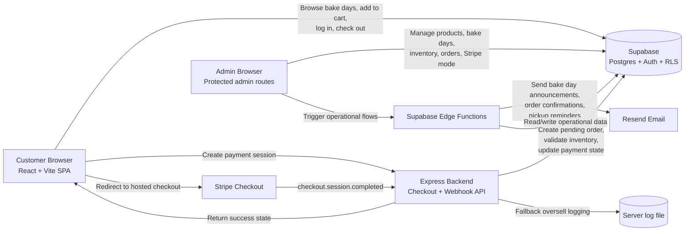

# Grane Bakery Frontend

This repository contains the customer-facing storefront, account experience, and admin UI for Grane Bakery. It is one half of a two-repository system. The companion backend repository handles Stripe checkout session creation and webhook processing, but this README intentionally explains the full product architecture so a recruiter can understand the entire application from either repo.

## What This Project Solves

Grane Bakery is a preorder system for a microbakery that sells small-batch products on specific bake days instead of keeping a permanent catalog in stock. The business problem is not just "sell bread online." It is coordinating a limited-production food business where:

- inventory changes by bake day, not just by product
- customers need a simple preorder flow with clear pickup expectations
- the owner needs to publish menus, cap quantities, and manage orders without enterprise tooling
- checkout must feel reliable even though inventory is inherently time-sensitive
- operational follow-up matters just as much as payment: confirmation emails, bake day announcements, and pickup reminders close the loop

This system addresses that by modeling the business around scheduled production windows. Customers pick a bake day first, then order from the products attached to that date. That choice drives the data model, the UI, and the payment flow.

## Why This Frontend Is Strong Engineering Work

The frontend is not a generic ecommerce shell. It translates the bakery's operating model directly into the user experience:

- it makes bake day selection the primary organizing concept
- it supports both guest checkout and authenticated customer accounts
- it includes a meaningful admin tool for operational management, not just customer pages
- it handles state persistence and post-payment recovery in a way that fits the constraints of small-batch inventory

This repo is where most of the product thinking is visible. The code shows how the business rules become interface rules.

## This Repository's Role

This repository is the React 19 + TypeScript + Vite application in which customers and admins spend most of their time. Routing in [`src/App.tsx`](C:/repos/grane/grane-frontend/src/App.tsx) makes the application structure explicit:

- public storefront pages for discovery and ordering
- authenticated account pages for customer profile and order history
- protected admin routes for operations management
- a payment success page that reads Stripe session status back from the backend

The frontend talks directly to Supabase for most data and auth concerns through [`src/api/supabaseClient.ts`](C:/repos/grane/grane-frontend/src/api/supabaseClient.ts), while payment-sensitive operations go through the separate backend repository.

## Full-System Architecture

### Frontend

The customer and admin experiences live here in [`grane-frontend`](C:/repos/grane/grane-frontend). This repo owns:

- routing and page composition
- cart state and persistence
- account and admin authorization flows
- direct Supabase CRUD access for most business data
- the UI around ordering, pickup communication, and operations management

### Backend

The companion Express service in the backend repository exists for the parts of the system that should not live in the browser:

- creating Stripe Checkout sessions
- validating inventory before payment session creation
- receiving Stripe webhooks
- marking orders paid and applying inventory only after confirmed payment

This is a good boundary. The browser never handles Stripe secret keys, and inventory mutation happens server-side after Stripe confirmation.

### Supabase as the System Backbone

Supabase acts as more than "just a database." In this project it is effectively the business platform:

- `auth.users` plus `public.users` support both authenticated customers and guest checkout profiles
- relational tables model products, bake days, bake-day-specific inventory, orders, and order items
- row-level security and an `is_admin()` RPC back the admin authorization model
- the frontend uses Supabase directly for most CRUD workflows, which reduces custom backend surface area

The code in [`src/api/auth.ts`](C:/repos/grane/grane-frontend/src/api/auth.ts) shows a thoughtful identity model: authenticated users are synchronized into `public.users`, while guest buyers can still exist in the business domain without having full auth accounts.

### Edge Functions for Operations

Operational messaging is split into Supabase Edge Functions:

- [`supabase/functions/order-confirmation-email/index.ts`](C:/repos/grane/grane-frontend/supabase/functions/order-confirmation-email/index.ts)
- [`supabase/functions/announce-bake-day/index.ts`](C:/repos/grane/grane-frontend/supabase/functions/announce-bake-day/index.ts)
- [`supabase/functions/send-pickup-reminders/index.ts`](C:/repos/grane/grane-frontend/supabase/functions/send-pickup-reminders/index.ts)

That separation is a strong design choice. Checkout remains focused on payment and inventory, while email workflows can be triggered independently and use service-role access where appropriate.

## Customer Experience Flow

### 1. Landing and Discovery

[`src/pages/Home.tsx`](C:/repos/grane/grane-frontend/src/pages/Home.tsx) is not a generic ecommerce homepage. It immediately frames the business as a small-batch preorder bakery with local pickup. That is a product decision as much as a UI decision: it sets expectations before the customer reaches checkout.

### 2. Bake-Day-First Ordering

[`src/pages/BakeDays.tsx`](C:/repos/grane/grane-frontend/src/pages/BakeDays.tsx) is the core of the domain model. Customers choose a date before assembling an order. The page:

- fetches only published bake days
- shows availability by date through a custom calendar
- enforces a three-day order deadline in the UI
- prevents users from mixing items across bake days
- surfaces low-stock and sold-out states per bake day product

This is a strong product-specific adaptation of ecommerce. Instead of bending the bakery into a standard "cart first, fulfillment later" flow, the application makes the production schedule the primary object.

### 3. Cart Persistence Without Fake Reservations

[`src/context/CartContext.tsx`](C:/repos/grane/grane-frontend/src/context/CartContext.tsx) is one of the most interesting files in the repo because it reveals deliberate trade-offs:

- cart state persists to `localStorage`
- persisted state is versioned and expires after seven days
- tabs stay in sync through the `storage` event
- state is restored after returning from Stripe via the browser back/forward cache
- expired bake days and unavailable products are actively cleaned up

The key design choice is that cart persistence improves continuity but does not reserve inventory. That is the right call for a small-batch bakery. It avoids holding stock for abandoned carts and avoids the operational complexity of lease-based inventory reservations.

### 4. Checkout With Auth-Optional Ordering

[`src/pages/CheckoutPage.tsx`](C:/repos/grane/grane-frontend/src/pages/CheckoutPage.tsx) supports both guest checkout and logged-in checkout. That reduces friction for first-time customers while still allowing repeat customers to benefit from stored profile data and order history.

The page also includes pragmatic resilience:

- timeout handling around session lookup and checkout requests
- server-side validation mirrored by clear client-side validation
- pickup messaging embedded directly in the flow
- sign-out support when autofilled account data is not the desired contact info

### 5. Payment Confirmation

[`src/pages/Success.tsx`](C:/repos/grane/grane-frontend/src/pages/Success.tsx) does not assume redirect success equals payment success. It asks the backend to confirm the Stripe session and then clears the cart only after confirmation data is received. That is a subtle but important trust boundary.

## Admin and Operations Design

The admin area is not decorative. It encodes the day-to-day workflow the bakery owner actually needs.

### Authorization Model

Admin access is enforced in [`src/routes/AdminRoute.tsx`](C:/repos/grane/grane-frontend/src/routes/AdminRoute.tsx) via the `is_admin()` RPC exposed through [`src/api/admin.ts`](C:/repos/grane/grane-frontend/src/api/admin.ts). The code comments are explicit that admin status comes from the `user_roles` table, not from client-side assumptions or metadata flags.

That is the right source of truth. It keeps authorization in the data layer instead of sprinkling role logic through UI state.

### Bake Day and Inventory Management

The admin workflow is centered around bake days:

- [`src/pages/admin/AdminBakeDays.tsx`](C:/repos/grane/grane-frontend/src/pages/admin/AdminBakeDays.tsx) creates, edits, publishes, and deletes bake days
- [`src/pages/admin/AdminBakeDayDetail.tsx`](C:/repos/grane/grane-frontend/src/pages/admin/AdminBakeDayDetail.tsx) assigns products to a bake day and sets `quantity_limit`, `quantity_sold`, and availability

This is a sensible operations model for a microbakery. Inventory is managed at the product/date intersection, which mirrors how production is actually planned.

### Safe Stripe Environment Switching

[`src/pages/admin/AdminHome.tsx`](C:/repos/grane/grane-frontend/src/pages/admin/AdminHome.tsx) includes a Stripe mode toggle driven by app settings. That is a notable operational feature because it lets the owner switch new checkout sessions between sandbox and live mode without code changes or redeploys.

This is a strong example of reducing operational risk through productized configuration instead of relying on tribal knowledge.

## Backend Design Decisions That Matter to This Frontend

Even though the backend lives in a separate repository, a hiring manager reading this frontend repo should understand the key contract points:

- the backend creates a pending order before redirecting to Stripe so the frontend always has a durable order path after payment
- inventory is applied on Stripe webhook completion, not on client redirect
- webhook processing uses `inventory_applied_at` to avoid double-counting inventory
- oversell risk is handled as a best-effort, explicitly accepted trade-off rather than hidden accidental behavior

That architecture matters because the frontend is designed around those guarantees.

## Important Trade-Offs and Why They Make Sense

### Trade-Off 1: Best-Effort Inventory Instead of Hard Reservation

The most important architectural trade-off is documented in [`OVERSELL_IMPLEMENTATION.md`](C:/repos/grane/OVERSELL_IMPLEMENTATION.md) and reflected in both [`src/context/CartContext.tsx`](C:/repos/grane/grane-frontend/src/context/CartContext.tsx) and the backend webhook logic.

Decision:
- do not reserve inventory when a customer adds items to cart
- validate availability at checkout
- detect and log oversells during webhook processing if parallel purchases slip through

Why this is reasonable:
- the business is a microbakery, not a high-volume warehouse
- abandoned-cart reservation would add complexity and create stale inventory problems
- the owner can manually intervene in the rare oversell case
- the code remains simpler, cheaper to operate, and easier to trust

What is sacrificed:
- strict prevention of race-condition oversells

What is gained:
- a much simpler system that still handles the common case well

### Trade-Off 2: Supabase-Heavy Architecture Instead of a Large Custom API

Decision:
- use Supabase directly from the frontend for most business data
- keep the separate backend only for payment-critical flows

Why this is strong:
- reduces backend code and deployment burden
- leverages built-in auth, relational querying, and row-level security
- speeds up iteration for admin tooling and account features

### Trade-Off 3: Support Guest Checkout and Authenticated Accounts

Decision:
- let customers order without creating an account
- still support authenticated profiles, saved data, and protected order history

Why this matters:
- guest checkout reduces friction for a low-frequency local purchase
- accounts improve retention for repeat customers

## Notable Technical Strengths Visible in This Repo

- The app models inventory at the `bake_day_products` level, which captures a real business constraint many ecommerce demos ignore.
- The identity layer distinguishes authenticated users from guest purchasers without losing referential integrity in the business tables.
- The cart persistence logic handles cross-tab sync, data expiry, and browser back/forward cache restoration.
- The admin UI is operationally meaningful, especially around bake day publishing and quantity management.
- Environment switching for Stripe is promoted to a managed admin setting instead of being a deploy-time-only concern.
- Operational messaging is treated as part of the product, not as an afterthought.

## Tech Stack

- Frontend: React 19, TypeScript, Vite, React Router
- Data/Auth: Supabase Postgres, Supabase Auth, Row-Level Security, RPC
- Payments: Stripe Checkout through a separate Express backend
- Messaging: Supabase Edge Functions + Resend
- Styling/UI: Tailwind CSS, Lucide icons

## Closing Summary

This frontend stands out because it is not a thin UI layer pasted on top of CRUD. It encodes the bakery's operating model directly into the customer journey and admin workflow. The strongest signal to a recruiter is not just that it uses modern tools. It is that the interface architecture reflects real product constraints and works cleanly with the backend and data model around it.
